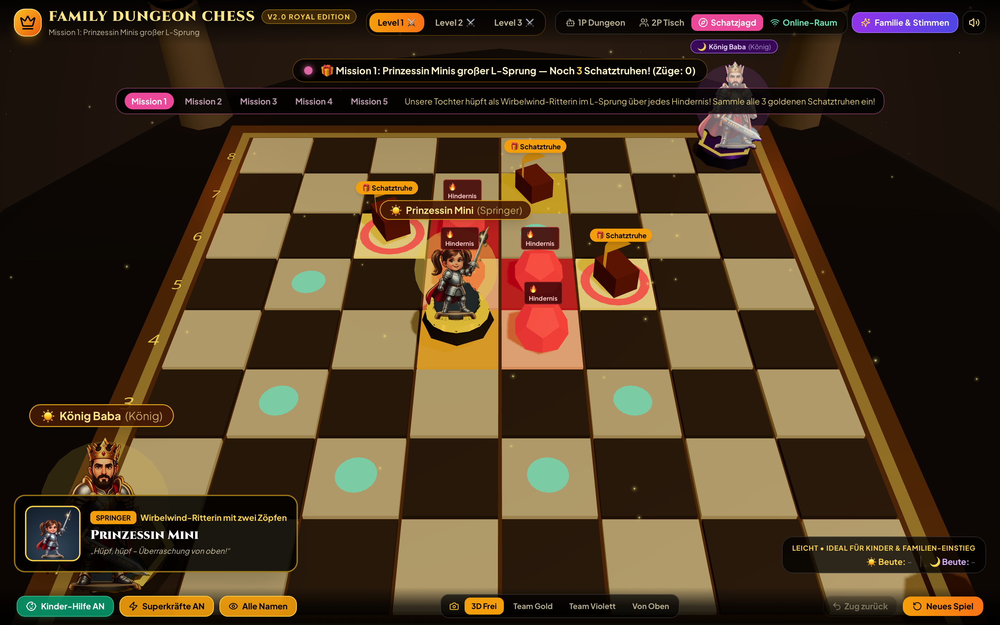
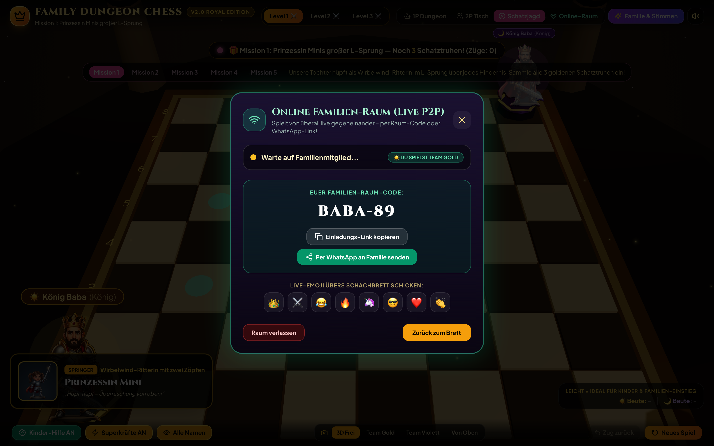

# 🏰 Family Dungeon Chess 3D – v2.0 Royal Edition

<p align="center">
  
</p>

<p align="center">
  <strong>Ein plattformunabhängiges 3D-Dungeon-Schachspiel für die ganze Familie – mit uns selbst als 3D-Schachfiguren!</strong><br/>
  Entwickelt mit <code>React 18</code> • <code>Three.js / React Three Fiber</code> • <code>chess.js</code> • <code>PeerJS (WebRTC)</code> • <code>Tailwind CSS</code> • <code>Web Audio API</code>
</p>

---

## ✨ Die Idee & Highlights (inkl. v2.0 Mega-Update!)

**Family Dungeon Chess 3D** verbindet klassisches Schach mit der Atmosphäre eines epischen **3D-Dungeon-Rollenspiels** (*Battle Chess* / *Clash Royale* / *Tabletop-Miniaturen*-Look). Das Besondere: **Jede Schachfigur ist ein echtes Familienmitglied**, verwandelt in eine liebevoll gestaltete 3D-Helden-Miniatur auf einem mystischen Runen-Sockel!

### 👑 Unsere Familien-Besetzung & Dungeon-Superkräfte (1× pro Partie)

<p align="center">
  
</p>

| Schachfigur | Familienmitglied | Dungeon-Klasse & Ausrüstung | ⚡ Einmalige Superkraft im Spiel |
| :--- | :--- | :--- | :--- |
| **König (`King`)** | **Der Familien-König (Papa)** – *mit schwarzem Haar & Vollbart* | **Paladin des Goldenen Throns** mit Königskrone, rotem Umhang & leuchtendem Runenschwert | 🛡️ **Goldener Königsschild:** Schützt eine eigene Figur 1 Runde lang mit einer goldenen 3D-Energiekuppel |
| **Dame (`Queen`)** | **Die Königin (Mama)** – *mit edlem Kopftuch & Diadem* | **Erzmagierin des Sternenlichts** in violett-goldenem Gewand mit funkelnden Magie-Sphären | ✨ **Sternenlicht-Teleport:** Hüllt König & Dame in einen Schutzschild und zeigt sofort den besten Gewinnzug |
| **Springer (`Knight`)** | **Unsere Tochter** – *mit den zwei Zöpfen* | **Wirbelwind-Ritterin** mit rotem Abenteurer-Cape & funkelndem Sternen-Degen | 🦄 **Wirbelwind-Doppelzug:** Nach ihrem Zug (ohne Schachgebot) darf dein Team sofort ein zweites Mal ziehen! |
| **Läufer (`Bishop`)** | **Die Tante** – *mit cooler Sonnenbrille & Blazer* | **Runen-Meisterin & Königliche Beraterin** mit blauem Saphir-Kristallstab | 😎 **Sonnenbrillen-Blendung:** Friert die stärkste gegnerische Figur für 1 Runde in einem 3D-Eiskristall ein |
| **Turm (`Rook`)** | **Der Cousin** | **Koloss der Steinernen Zitadelle** auf einem 3D-Burgzinnen-Sockel mit Titanen-Panzerfäusten | 🏰 **Festungs-Beben:** Macht den ausgewählten Turm für 1 Runde unverwundbar |
| **Bauer (`Pawn` – 2 Skins!)** | **Beide Cousinen von der Parkbank!** (*Cousine Dolch* & *Cousine Rune* im Hahnentritt-Kleid mit Kopftuch) | **Schatten- & Runen-Garde** mit Zwillingsdolchen & violettem Arkan-Bogen (wechseln sich auf den 8 Bauernfeldern ab!) | ⚡ **Cousinen-Teamgeist:** Errichtet einen leuchtenden Runenschild & krönt Bauern auf der letzten Reihe zur Königin! |

---

## 📸 Screenshots aus dem Live-Spiel

### 1. Level 1: Die Königliche Tor-Halle (mit beiden Cousinen-Skins & Superkraft-Button)
> Beide Cousinen wechseln sich in der Bauern-Reihe ab (*Cousine Dolch* & *Cousine Rune* im Hahnentritt-Gewand). Unten links erscheint der **„⚡ Superkraft zünden!“**-Button der ausgewählten Figur:


### 2. Neu in v2.0: Prinzessin Minis Schatzjagd (Kinder-Abenteuermodus)
> 5 spielerische Missionen mit rotierenden goldenen **3D-Schatztruhen** (`🎁`) und **Lava-Hindernissen** (`🔥`), mit denen Kinder die Zugregeln von Springer, Dame, Läufer, Turm und König lernen:



### 3. Neu in v2.0: Online-Familien-Raum (Live P2P per Raum-Code & WhatsApp-Link)
> Ohne Account erstellen: Raum-Code (`BABA-XX`) per WhatsApp in die Familiengruppe schicken und live von überall gegeneinander spielen – inklusive **Live-Emoji-Reaktionen** über dem 3D-Schachbrett:



### 4. Level 2 & Level 3: Kristall-Katakomben & Drachen-Schmiede


### 5. Familien-Helden & Sprachstudio (`🎤 Echte Stimme aufnehmen`)
> Im **„Familie & Stimmen“**-Menü lassen sich nicht nur alle Namen und Sprüche ändern, sondern auch **echte Mikrofon-Sprachaufnahmen** für jedes Familienmitglied aufnehmen, die beim Schlagen einer Figur abgespielt werden:


---

## 🎮 Alle 6 Ausbau-Features im Überblick

1. **🎙️ Echte Familien-Sprachaufnahmen im Spiel:** Über `Familie & Stimmen` → `Echte Stimme aufnehmen` kann jedes Familienmitglied seinen eigenen Kampfspruch direkt per Mikrofon einsprechen.
2. **⚡ Dungeon-Superkräfte (1× pro Partie):** Jede Rolle besitzt ihre eigene taktische Spezialfähigkeit mit 3D-Schutzschild-Kuppel (`🛡️`), Eiskristall-Einfrierung (`❄️`) oder Doppelzug (`🦄`) – unten in der Leiste jederzeit an-/abschaltbar.
3. **🌍 Online-Familien-Raum per WhatsApp-Link (PeerJS WebRTC):** Erstellt einen Raum-Code (`BABA-XX`) oder teilt den Direkt-Link (`?room=BABA-XX`) per WhatsApp, damit Tante & Cousinen von zuhause aus live mitspielen können.
4. **⚔️ Battle-Chess 3D-Duell-Animation:** Beim Schlagen zoomt die Kamera nah heran, eine 3D-Licht-/Schwert-Säule blitzt auf, das Duell-Banner zeigt Angreifer vs. Verteidiger und die geschlagene Figur schwebt sanft am Fallschirm (`🪂`) auf die Bank.
5. **🧭 Prinzessin Minis Schatzjagd:** 5 eigene Lern-Missionen mit goldenen 3D-Schatztruhen und Hindernissen.
6. **👗 Beide Cousinen auf dem Schachbrett:** Sowohl die Cousine mit langen dunklen Haaren (`pawn.png`) als auch die Cousine im Hahnentritt-Kleid mit schwarzem Kopftuch (`pawn2.png`) stehen abwechselnd in der Bauern-Garde!

---

## 🚀 Schnellstart & Installation

```bash
# 1. Repository klonen
git clone https://github.com/NexusHero/Chess.git
cd Chess

# 2. Abhängigkeiten installieren
npm install

# 3. Entwicklungs-Server starten (läuft lokal & im Heim-WLAN für Handy/Tablet)
npm run dev
```

Öffne anschließend **`http://localhost:5173/`** im Browser.
