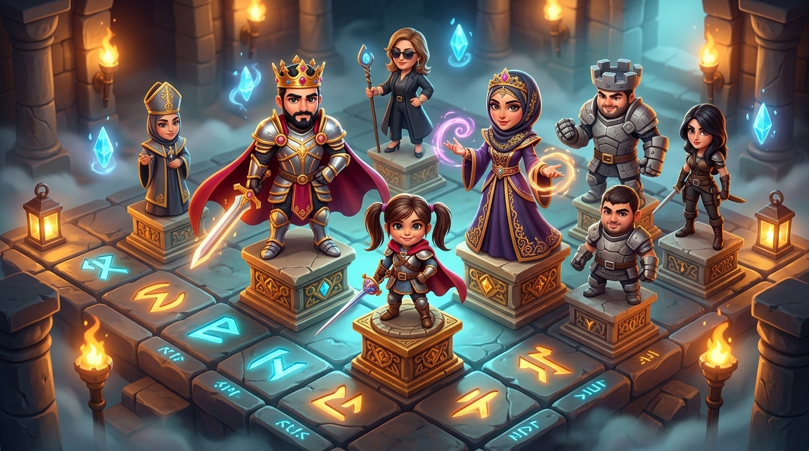
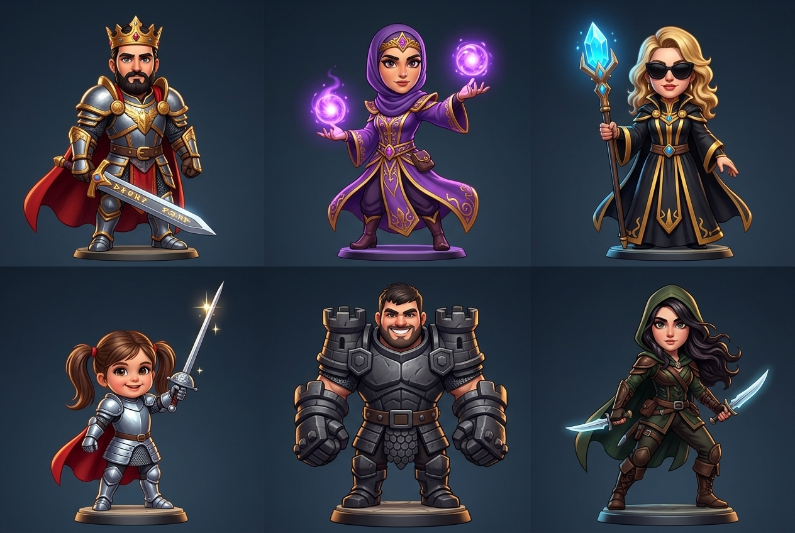
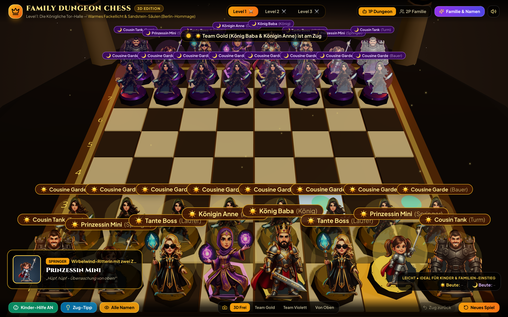
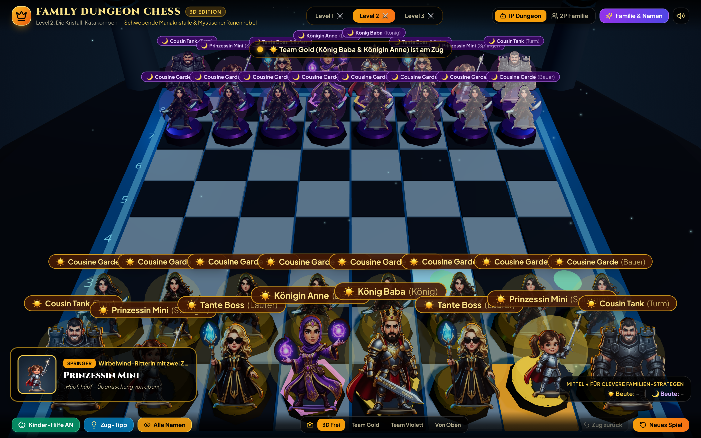
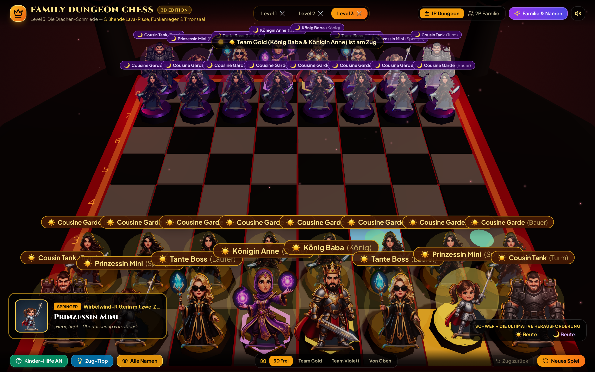
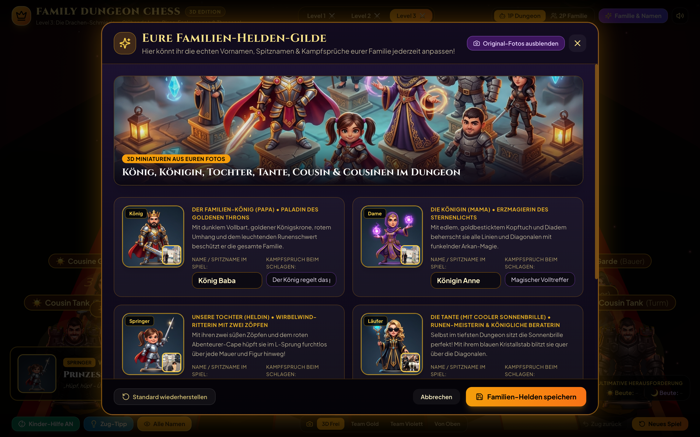

# 🏰 Family Dungeon Chess 3D – Die Helden-Gilde

<p align="center">
  
</p>

<p align="center">
  <strong>Ein plattformunabhängiges 3D-Dungeon-Schachspiel für die ganze Familie – mit uns selbst als 3D-Schachfiguren!</strong><br/>
  Entwickelt mit <code>React 18</code> • <code>Three.js / React Three Fiber</code> • <code>chess.js</code> • <code>Tailwind CSS</code> • <code>Web Audio API</code>
</p>

---

## ✨ Die Idee & Highlights

**Family Dungeon Chess 3D** verbindet klassisches Schach mit der Atmosphäre eines epischen **3D-Dungeon-Rollenspiels** (*Battle Chess* / *Clash Royale* / *Tabletop-Miniaturen*-Look). Das Besondere: **Jede Schachfigur ist ein echtes Familienmitglied**, verwandelt in eine liebevoll gestaltete 3D-Helden-Miniatur auf einem mystischen Runen-Sockel!

### 👑 Unsere Familien-Besetzung (Die 6 Schach-Rollen)

<p align="center">
  
</p>

| Schachfigur | Familienmitglied | Dungeon-Klasse & Ausrüstung | Spezial-Effekt im Spiel |
| :--- | :--- | :--- | :--- |
| **König (`King`)** | **Der Familien-König (Papa)** – *mit schwarzem Haar & Vollbart* | **Paladin des Goldenen Throns** mit Königskrone, rotem Umhang & leuchtendem Runenschwert | Goldene Rotations-Aura am Sockel & pulsierender Gefahrenschild bei *Schach!* |
| **Dame (`Queen`)** | **Die Königin (Mama)** – *mit edlem Kopftuch & Diadem* | **Erzmagierin des Sternenlichts** in violett-goldenem Gewand mit funkelnden Magie-Sphären | Schwebender Arkan-Ring & mächtige Lichtexplosion beim Schlagen |
| **Springer (`Knight`)** | **Unsere Tochter** – *mit den zwei Zöpfen* | **Wirbelwind-Ritterin** mit rotem Abenteurer-Cape & funkelndem Sternen-Degen | Springt in einer extra-hohen Parabel-Kurve über alle anderen Figuren hinweg! |
| **Läufer (`Bishop`)** | **Die Tante** – *mit cooler Sonnenbrille & Blazer* | **Runen-Meisterin & Königliche Beraterin** mit blauem Saphir-Kristallstab | Gleitet diagonal über das Brett mit coolen Sprüchen |
| **Turm (`Rook`)** | **Der Cousin** | **Koloss der Steinernen Zitadelle** auf einem 3D-Burgzinnen-Sockel mit Titanen-Panzerfäusten | Walzt ganze Linien frei |
| **Bauer (`Pawn`)** | **Die Cousinen** | **Schatten-Waldläuferinnen** mit Zwillings-Runendolchen | Werden auf der letzten Reihe automatisch mit Konfetti & Fanfare zur Königin gekrönt! |

---

## 📸 Screenshots aus dem Live-Spiel

### 1. Level 1: Die Königliche Tor-Halle (Warmes Fackellicht & Kinder-Hilfe)
> Mit aktiviertem **Zug-Tipp**, **Namen-Plaketten** über allen 32 Figuren und leuchtenden grünen Runen-Punkten für erlaubte Züge:



### 2. Level 2: Die Kristall-Katakomben (Mystischer Saphir-Nebel)
> Tiefer im Gewölbe mit blauen Manakristallen, leuchtenden Runenfeldern und taktischer Mittel-KI:



### 3. Level 3: Die Drachen-Schmiede (Obsidian & Lava-Glut)
> Das Finale im Thronsaal über glühenden Magma-Strömen gegen den Großmeister der Obsidian-Zitadelle:



### 4. Familien-Helden & Namen live im Spiel anpassen
> Im **„Familie & Namen“**-Menü lassen sich alle Vornamen, Spitznamen und Kampfsprüche jederzeit individuell ändern (inklusive Vorher/Nachher-Vergleich mit den echten Familienfotos):



---

## 🎮 Spielmodi & Features

- **⚔️ 1-Spieler Dungeon-Kampagne (3 Levels):** Spiele mit **Team Gold-Licht** gegen 3 verschieden starke Dungeon-Bosse (Einsteiger, Fortgeschritten, Meister) und sammle bis zu **3 Kronen (👑)** pro Level.
- **👨‍👩‍👧 2-Spieler Familien-Duell (Pass & Play am selben Gerät):** Beide Seiten spielen mit unseren Familien-Figuren (**Team Gold-Licht ☀️** vs. **Team Kristall-Violett 🌙**) – ideal für Tablet, Smartphone oder Laptop auf dem Wohnzimmertisch.
- **💥 Action-Kamera & Sprechblasen beim Schlagen:** Wenn eine Figur geschlagen wird, zoomt die Kamera leicht heran, Funken sprühen und die Figur ruft ihren persönlichen Kampfspruch.
- **👶 Kinder- & Einsteiger-Hilfe (`Kinder-Hilfe AN/AUS`):** Zeigt auf Wunsch leuchtende grüne Zug-Runen, rote Angriffs-Ringe und bietet einen **„Zug-Tipp“**-Button, damit auch Kinder sofort mitspielen können.
- **🎥 4 Kamera-Perspektiven:** Frei drehbare 3D-Orbit-Kamera, Ansicht für *Team Gold*, Ansicht für *Team Violett* (automatischer Wechsel im 2-Spieler-Tischmodus) und klassische *Von-Oben*-Übersicht.
- **🔊 Prozeduraler Dungeon-Synthesizer:** Eigens über die Web Audio API erzeugte Schwerthieb-, Runen-, Schach- und Sieges-Fanfaren (komplett ohne externe Audio-Dateien, jederzeit stummschaltbar).

---

## 🚀 Schnellstart & Installation

Voraussetzungen: **Node.js** (v18+) und **npm**.

```bash
# 1. Repository klonen
git clone https://github.com/NexusHero/Chess.git
cd Chess

# 2. Abhängigkeiten installieren
npm install

# 3. Entwicklungs-Server starten (läuft lokal & im Heim-WLAN für Handy/Tablet)
npm run dev
```

Öffne anschließend **`http://localhost:5173/`** im Browser (oder die angezeigte `Network`-Adresse auf deinem Smartphone/iPad).

### Produktions-Build erstellen

```bash
npm run build
npm run preview
```

---

## 🗂️ Projektstruktur

```text
Chess/
├── public/
│   └── assets/
│       ├── heroes/          # Freigestellte 3D-Miniaturen & Porträts (King, Queen, Knight, Bishop, Rook, Pawn)
│       ├── photos/          # Familien-Referenzfotos für den Vorher/Nachher-Vergleich
│       ├── hero_sheet.jpg   # 6er-Charakter-Übersicht
│       └── pitch_banner.jpg # 3D-Konzept-Banner
├── docs/
│   └── screenshots/         # Live-Screenshots aller 3 Dungeon-Welten & Menüs
├── src/
│   ├── components/
│   │   ├── DungeonArena3D.tsx    # 3D-Dungeon-Umgebung, Fackeln, Schachbrett & Kamera-Regie
│   │   ├── FamilyHeroPiece3D.tsx # 3D-Sockel, Sprung-Physik, Auren & Familien-Miniaturen
│   │   └── FamilyHeroModal.tsx   # Live-Editor für Namen, Spitznamen & Kampfsprüche
│   ├── data/
│   │   └── familyConfig.ts       # Konfiguration der 6 Familien-Helden & 3 Dungeon-Levels
│   ├── utils/
│   │   ├── chessAI.ts            # Minimax-Schach-KI (3 Schwierigkeitsstufen + Zug-Tipp)
│   │   └── sound.ts              # Web Audio API Dungeon-Soundeffekte
│   ├── App.tsx                   # Hauptanwendung, Spiel-Logik & HUD
│   └── main.tsx                  # Einstiegspunkt
└── README.md
```
